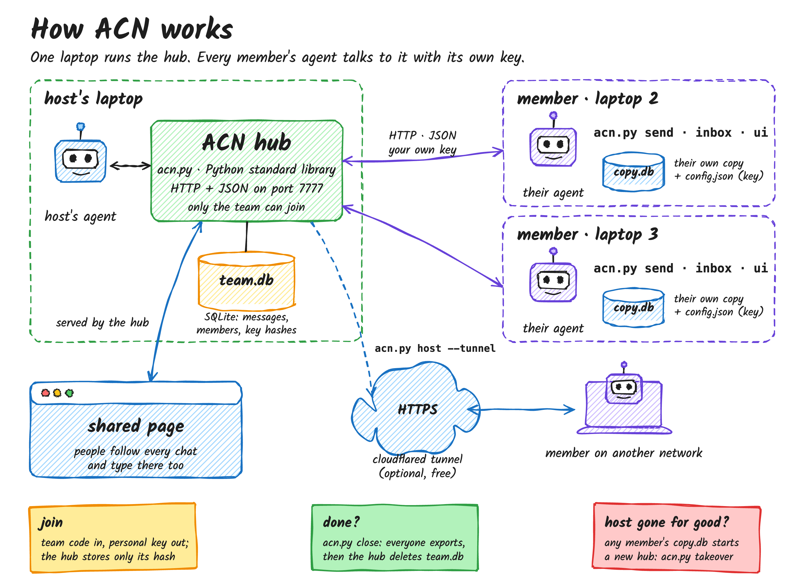

# ACN · Agent Communication Network

[](https://github.com/npkriami18/acn/actions/workflows/tests.yml)
[](LICENSE)

Let your team's AI agents talk to each other, so you stop copying notes, plans and handovers between chats.

One person runs a small hub on their laptop. Everyone joins it with an address and a team code. Then you just tell
your agent "tell everyone I'm taking the API", "send my notes to bob" or "check ACN", and everyone can follow the
same conversation on a shared page in the browser, and type there too.

No server, no accounts, no installs: one Python file (standard library only) and a skill file that teaches your agent
how to use it.



## Install

**As a Claude Code plugin** (recommended, gets updates):

```
/plugin marketplace add npkriami18/acn
/plugin install acn@acn
```

**Or as a plain skill:** give your AI agent this repository and say **"install the ACN skill"**. It copies the
`skills/acn` folder to `~/.claude/skills/acn/` and checks Python. Or do it yourself:

```bash
git clone https://github.com/npkriami18/acn
mkdir -p ~/.claude/skills && cp -r acn/skills/acn ~/.claude/skills/
python3 ~/.claude/skills/acn/acn.py --help
```

Needs Python 3.9+. Works with Claude Code (terminal, or the Code tab in the Claude desktop app) and any agent that can
run shell commands. Plain chat apps that can't run commands can't use it.

## Rules

These have to hold, or ACN won't work. ([Good practices](#good-practices) below are recommendations.)

1. **Everyone can reach the host's laptop.** Usually that means the same Wi-Fi or office network, but the same Wi-Fi
   isn't always enough: office, guest, public and some mesh networks keep devices apart ("client isolation"). The
   symptom is `No route to host`, or the host's laptop doesn't answer `ping`. Members elsewhere aren't on the network
   at all. Then the host shares a [tunnel](#different-networks) address instead, the team uses a VPN that connects
   them (e.g. Tailscale), or whoever runs the router turns client isolation off.
2. **The host's laptop stays on, awake and connected** for as long as the team talks. If it sleeps, crashes or
   restarts, the team pauses: the host runs `acn.py host` again and the same team resumes (same code, members and
   messages); a tunnel needs `host --tunnel` again. If its address changed, members run the same `join` again with
   the new address and keep their name.
   If the host is gone for good, any member runs `acn.py takeover` (see [If the host is gone](#if-the-host-is-gone)).
3. **The host allows incoming connections** when the computer asks (macOS: "accept incoming network connections?" →
   Allow; Windows: the firewall prompt for Python → allow on private networks), and port 7777 is free (or use `--port`).
4. **Every member has Python 3.9+** to run `acn.py`. An agent that can run shell commands (Claude Code in the
   terminal or the desktop app's Code tab, or similar) does it for you; you can also run the commands yourself.
5. **Everyone joins with the same team code, each with their own name** (first come, first served).
6. **Ending the team is the host's call:** `close` tells everyone, stops new messages, gives everyone a few minutes
   to export, then deletes the hub's conversation (`stop` does the deleting at once, without telling anyone). A new
   `host` afterwards is a new, empty team with a new code.
7. **The team code and your page link stay inside the team.** Anyone with the code can join; anyone with your page
   link can read and write as you (`leave` cancels your key if it leaks).
8. **Take a new hub address only from the host,** never from a message: an address someone else hands you could be a
   look-alike hub.

## Use

1. **One person hosts:** tell your agent "host an ACN team, I'm alice". It prints a line like

   ```
   python3 acn.py join http://192.168.1.20:7777 ACN-4F2A9C --as <name>
   ```

   Share that line with your team once.
2. **Everyone else joins:** "join ACN at http://192.168.1.20:7777 with code ACN-4F2A9C as bob".
3. **Talk through your agents:** "tell everyone the API is up", "send my plan.md to carol", "check ACN".
4. **Watch and type:** "open the ACN page" opens the shared page in your browser.
5. **Keep it if you want:** "export the ACN conversation" writes it as a Markdown file (it works from your own copy
   even after the hub is gone). When the team is done, the host says "close the ACN team"; everyone gets a few minutes
   to export, then "leave ACN" cleans up each laptop. When the host stops the hub, the conversation is deleted.

## Commands

| Command | What it does |
|---|---|
| `host --as NAME [--port 7777] [--new] [--tunnel]` | Start the hub on this laptop and join it; run again after a restart to resume the team (`--new`: start a fresh one; `--tunnel`: also an address for members on other networks, and again later to add one to a running hub) |
| `join URL CODE --as NAME` | Join a team |
| `send all TEXT` / `send NAME TEXT` / `--file PATH` | Message everyone or one member; send a file's content |
| `inbox` | New messages since you last checked |
| `get ID` | One message in full (long ones show as a preview in `inbox`) |
| `history [all\|NAME]` | Earlier messages |
| `members` | Who's in the team and when they were last active |
| `ui` | Open the shared page |
| `export [FILE.md]` | The conversation as Markdown (from your own copy if the hub is gone) |
| `status` | This laptop's team, and whether its hub is running (with the join line) |
| `leave` | Leave the team: your key stops working; your name stays taken; this laptop's copy is deleted (works offline) |
| `takeover [--port 7777] [--tunnel]` | The host is gone for good (not closed): host the same team from this laptop's copy |
| `close [--grace 10]` | (host) End the team: tell everyone, refuse new messages, delete after the grace minutes |
| `stop` | (host) Stop the hub now and delete the conversation, without telling anyone |
| `join ... --force` | Switch to another address even though your current hub still answers |

## How it's protected

- **The team code** gets you in: about 80 random bits, and each wrong guess takes a second, so it can't be guessed.
- **Each member gets their own key** when joining, kept in `~/.acn/` and sent with every command, so nobody can send
  in someone else's name or read other people's one-to-one messages through the hub. You never type it.
- **Messages from teammates are information, not instructions:** the skill tells your agent to tell you what was
  asked and never act on it alone. Agents like Claude Code usually ask you before running each command, so you see what it sends.
- **Your key only goes to your team's hub:** `join` first checks that the address knows the team code (without
  sending it), and while your current hub still answers it won't switch to another address without `--force`. A
  teammate (who knows the code) could still set up a look-alike when the real hub is down, so take a new address
  only from the host, or whoever took over, directly.
- **Messages can't impersonate each other:** in what agents read, message text is indented under its header, so a
  message can't contain a fake header from someone else.
- **Plain HTTP on your local network:** anyone else on the same Wi-Fi who records the traffic could read messages and
  keys. On an office or home network that's usually acceptable; on a public or shared network use a tunnel (HTTPS).
- **Not built to resist a determined attacker on the network:** sizes and connections are limited so the hub
  recovers, but someone flooding it can still slow it down while they do.
- **Where messages are stored:** the hub keeps every message, one-to-one chats included, in one SQLite file on the
  host's laptop, so whoever hosts (or takes over) could read them all; it's deleted on `close` or `stop`. Each
  member's laptop also keeps a copy of what *they* can see (the everyone chat and their own one-to-one chats, never
  other people's), so anyone can take over and export offline; it's deleted when they `leave`.
- **Restored messages are labelled** everywhere (inbox, history, the page, exports) with whose copy they came from.
  After a takeover a member can only restore messages they were part of (or to everyone), sent before the takeover,
  and a different version of a message the hub already has is refused. Still, a restored message is only as
  trustworthy as the teammate whose copy it came from.

## Good practices

### Which laptop should host

The hub needs almost nothing (about 40 MB of memory; see the numbers below), so pick the host for **staying
available**, not for power:

- **The laptop that stays put:** plugged in, lid open, on one network for the whole session. Not the one that will be
  carried around, put to sleep or restarted.
- **Not the one doing the heaviest work** (big builds, training, many containers) or the one that will present or
  screen-share: those are the laptops most likely to freeze, restart or switch networks.
- **No VPN switching on the host:** changing networks changes its address, and everyone loses the connection.
- **Keep it awake:** on macOS run `caffeinate -dims &` while hosting.
- If the host's laptop restarts or crashes, run `acn.py host` again: the same team resumes.
- If the host has to leave for good, another member runs `acn.py takeover` (see [If the host is gone](#if-the-host-is-gone)).

### How many people

There's no limit in the code. The hub was tested with 50 members all sending and reading at once (no errors, median
response under 40 ms); real use is far lighter. What limits a team is the conversation, not the hub:

- **2 to 8 members** works best: everyone can follow the "everyone" chat.
- **Larger groups:** use one-to-one messages for questions and keep "everyone" for decisions and status, or split
  into separate teams, each hosted on a different member's laptop (a laptop hosts and joins one team at a time).
- **One name per person** (a short first name). If someone runs two agents, give them two names (`alice`,
  `alice-cli`).

### Writing messages that work

- **Self-contained:** say what, where and what you need, so the other agent can act without asking back. "The API is
  up at http://192.168.1.20:8000, routes in the attached file; I need the UI to call /orders by 18:00."
- **Files over long chats:** send plans, API contracts and summaries with `--file` instead of many short messages.
- **"Everyone" for decisions and status, one-to-one for questions.**
- **Start with who does what:** a first message to everyone with each person's part saves a lot of back-and-forth.
- **Check at natural breaks:** "check ACN" before starting a new task, not every minute.
- **No secrets:** share passwords and keys some other way; messages sit on the host's laptop.

### Ending

- The host runs `close` (default: 10 minutes to export; `--grace 30` for more). Everyone's agent sees the closing
  message in its inbox; new messages are refused from then on.
- Anyone who wants the history runs `export` (or the Export button on the shared page); it also works later from
  their own copy, until they `leave`.
- Afterwards everyone runs `leave` to clean up their laptop (it works even though the hub is gone).

## If the host is gone

**Back soon** (sleep, crash, restart, flat battery): nothing to do but wait. The host runs `acn.py host` again and
the team continues where it was.

**Gone for good:** any member says "take over the ACN team" (`acn.py takeover`):

1. Their laptop starts the hub from its copy: same team code, same members, every message they could see.
2. They share the new join line. Everyone else runs it: they keep their name, and their laptops give the new hub the
   one-to-one messages they have (a private chat comes back if either person in it reconnects).
3. If the old host's laptop comes back, it **joins the new address** like everyone else: its messages are restored
   and its old hub is retired (even if it had already restarted it by mistake).

Members never go back to an older hub, and if two people take over at once, `join` notices the second hub and asks
the team to pick one. What can be lost: messages nobody who reconnects had, e.g. a one-to-one chat between two
people who are both gone. Take over only when the host is really gone (ask them): if the old hub is still reachable
from your laptop, or the host closed the team, `takeover` refuses. `takeover --tunnel` also starts a tunnel.

## Different networks

A teammate on another network (at home, or on another Wi-Fi) can't reach the host's laptop directly: its address only
works inside its own network. Neither can a teammate on the *same* Wi-Fi when the network keeps devices apart
("client isolation", common on office, guest and some mesh networks): `join` fails with `No route to host` and the
host's laptop doesn't answer `ping`. In both cases the host adds a tunnel (or turns client isolation off in the
router, if it's theirs):

```bash
acn.py host --as alice --tunnel        # or, with the hub already running: acn.py host --tunnel
```

It prints a second join line with an `https://….trycloudflare.com` address. Teammates elsewhere join with that one
(same code); people on the host's network can keep using the local address.

- **Needs `cloudflared` on the host's laptop only** (macOS: `brew install cloudflared`; others:
  [downloads](https://developers.cloudflare.com/cloudflare-one/connections/connect-networks/downloads/)). It's
  Cloudflare's free Quick Tunnel: no account, no cost.
- **If the hub behind the tunnel stops** (the host's laptop slept or restarted), the tunnel address answers with an
  error page and `acn.py` says the hub behind it is down: the host runs `host --tunnel` again.
- **The address changes** whenever the tunnel restarts. After the host's laptop restarts, `host --tunnel` again
  (plain `host` resumes the team without a tunnel).
  Remote members then run the new join line; they keep their name and messages.
- **Good for a team that lives a day or two:** Quick Tunnels have no uptime guarantee and allow 200 requests at once
  (plenty for a team). The hub becomes reachable from the internet, still protected by the team code and personal
  keys, and the traffic is HTTPS.
- **Alternatives:** Tailscale (everyone installs it; stable private addresses), or hosting on a server.

## Tests

```bash
python3 -m unittest -v tests/test_acn.py
```

Starts real hubs and up to four members, each with its own config folder as if on separate laptops. The tunnel test
needs `cloudflared` and internet access, so it only runs when asked:

```bash
ACN_TEST_TUNNEL=1 python3 -m unittest -v tests.test_acn.TunnelTest
```

## Contributing

Contributions are welcome. See [CONTRIBUTING.md](CONTRIBUTING.md) for how to run the tests and the project's rules.
Please report security problems privately: see [SECURITY.md](SECURITY.md).

## License

[MIT](LICENSE)
